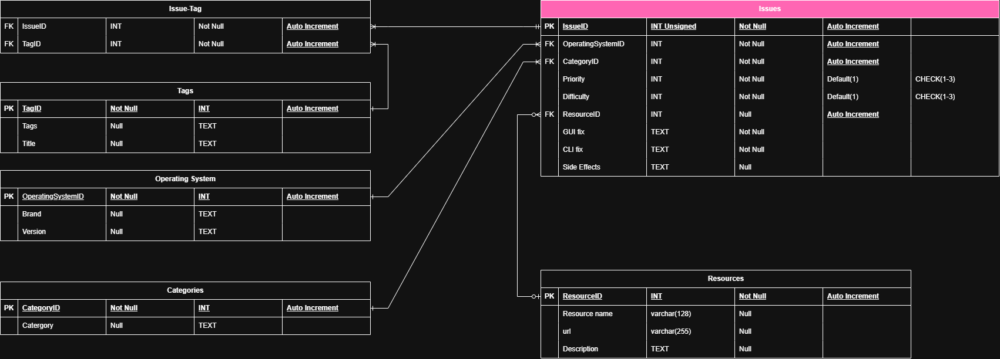

# Phase 3 — ERD

My database organizes troubleshooting solutions for the Hannibal CyberPatriot teams. Each record is a security problem that can be scored in a competition image, along with how to fix it.

## Tables

| Table | Real-world concept |
|---|---|
| **Issues** | A single scored security problem on a competition image (e.g., guest account enabled) and how to fix it: GUI steps, CLI steps, side effects, priority, and difficulty. This is the central table. |
| **Operating System** | A specific OS a fix applies to, split into brand (Windows, Ubuntu, Cisco) and version (10 Pro, 22.04). |
| **Categories** | The competition scoring area an issue belongs to, such as Accounts, Services, Firewall, Updates, or Policies. |
| **Resources** | An outside reference used when a fix needs more help, such as Microsoft or Ubuntu documentation (name, URL, description). |
| **Tags** | A searchable keyword used to label issues so teammates can find them quickly. |
| **Issue-Tag** | A junction table. Each row links one issue to one tag. It is not a real-world object by itself; it exists to connect Issues and Tags. |

## Relationships

**Operating System → Issues (one-to-many, mandatory)**
- One OS version can have many issues, but each issue is written for exactly one OS, because the fix steps differ between Windows and Linux. OperatingSystemID is Not Null since a fix without an OS is unusable.
- If modeled differently: storing the OS as text in Issues would repeat "Windows 10 Pro" on every row and allow typos ("Win 10 pro") that break searching. Making it many-to-many would mix different procedures into one record.

**Categories → Issues (one-to-many, mandatory)**
- One category holds many issues; each issue is scored under one category. CategoryID is Not Null so every issue can be grouped.
- If modeled differently: free text in Issues would create inconsistent category names and make "show all Firewall issues" unreliable. Many-to-many would make scoring areas ambiguous.

**Resources → Issues (one-to-many, optional on both sides)**
- One resource (like a documentation page) can support many issues, but an issue may have no resource at all, and a resource can exist before it is linked. That is why ResourceID in Issues allows Null.
- If modeled differently: making it mandatory would force fake placeholder resources onto simple fixes. Putting the URL directly in Issues would duplicate the same link many times and require updating every row when it changes.

**Issues ↔ Tags (many-to-many, through Issue-Tag)**
- One issue can have many tags (e.g., "accounts", "password", "windows") and one tag can apply to many issues. Issue-Tag holds one row per pairing, with a one-to-many from Issues to Issue-Tag and a one-to-many from Tags to Issue-Tag.
- If modeled differently: a single TagID column in Issues would allow only one tag per issue. A comma-separated tag list would break searching and could not use foreign keys. Without the junction table, a direct many-to-many cannot be built in MySQL.

## Hardest Relationship

Priority and Difficulty were the hardest. In Phase 2, I planned them as separate lookup tables (Priority ID and Difficulty ID as foreign keys). While drawing the ERD, I realized each table would only hold a short, fixed list of values that will not change, so the extra table and key added joins without adding information. I resolved it by making them INT columns directly in Issues with `CHECK (1–3)` and a default of 1, which keeps the values valid without the extra tables.

## Changes from Phase 2

| Change | Why |
|---|---|
| Removed the **Priority** and **Difficulty** tables; they are now INT fields in Issues with `CHECK (1–3)` and Default 1 | Fixed short lists did not need their own tables (see above). Priority was reduced from four levels to three to match Difficulty. |
| Added **ResourceID** as a nullable FK in Issues | In Phase 2, the Resource table had no connection to anything. Linking it lets each issue point to its reference. |
| **OperatingSystemID** and **CategoryID** changed from Null to **Not Null** | Every fix must belong to an OS and a category to be usable and scorable. |
| Procedure and description fields changed from varchar to **TEXT**; resource name and URL set to varchar(128) and varchar(255) | Step-by-step instructions can be long. Names and URLs have predictable lengths. |
| **IssueID** made INT Unsigned | IDs are never negative, and unsigned doubles the positive range. |
| Category **Name** renamed to **Category** | Clearer label in the diagram. |
